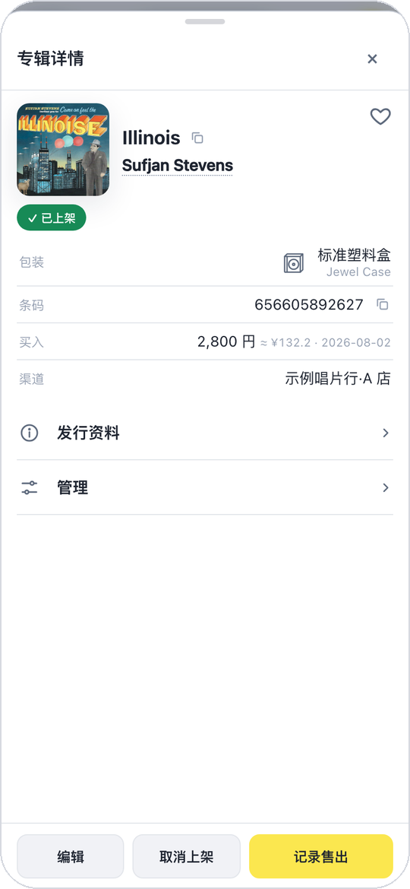
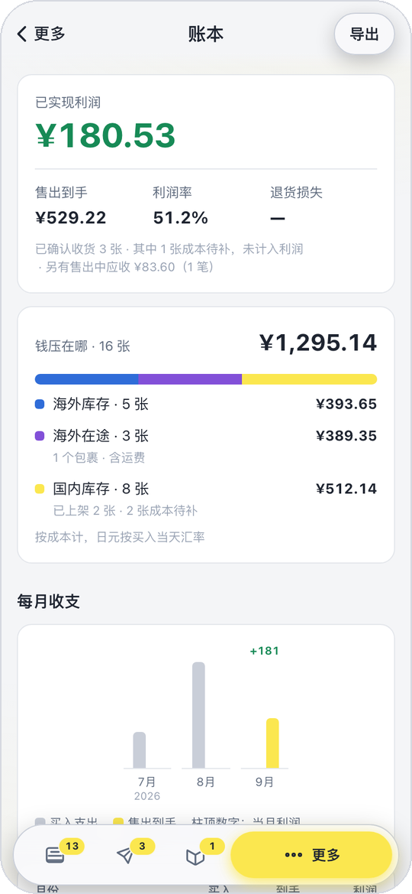
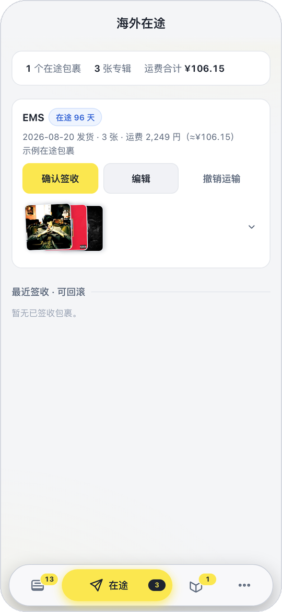
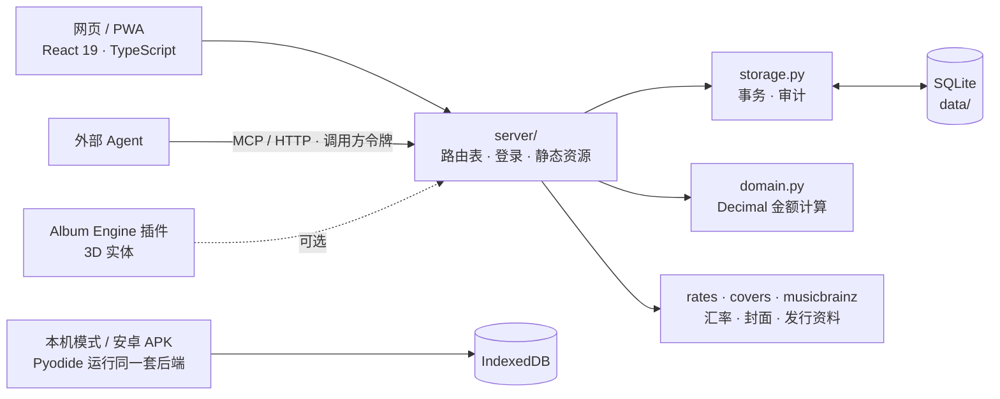

<div align="center">


# Obi

**让每一张唱片，都被好好记着。**

自托管的个人 CD 收藏与交易账本：**每张实物一条记录，带版本、照片与成本；能整理、能展示，也能记账和出二手**。<br>
单用户、不注册，数据只存在自己的设备上；服务端只用 Python 标准库，Docker 一键启动，没有服务器也能在手机上用。

[](https://github.com/Kihara-Ri/obi/releases)
[](LICENSE)


[](https://github.com/Kihara-Ri/obi/releases/latest)

[**介绍站**](https://kihara-ri.github.io/obi/) · [**下载安卓 APK**](https://github.com/Kihara-Ri/obi/releases/latest) · [使用说明](使用说明.md) · [部署说明](部署说明.md) · [更新记录](CHANGELOG.md)

</div>

> [!NOTE]
> 截图全部来自仓库自带的固定样本库（21 个虚构副本 + 真实封面），仓库与 git 历史不含任何个人数据。

## 快速开始

> [!TIP]
> **有服务器或 NAS（推荐）**：用 Docker，三行跑起来，数据落在 `./data`。
>
> ```sh
> git clone https://github.com/Kihara-Ri/obi && cd obi
> cp .env.example .env          # 按需填 PUBLIC_ORIGIN / 备份密钥
> docker compose up -d --build  # 打开 http://127.0.0.1:8765
> ```
>
> 升级 `git pull && docker compose up -d --build`；停止 `docker compose down`（数据保留）。

| 你的情况 | 怎么用 |
| --- | --- |
| 有服务器 / NAS | 上面的 Docker；公网访问（HTTPS 反代 + 登录密码 + 异地备份）见[部署说明](部署说明.md) |
| 只想在自己电脑上试 | `python3 app.py`（3.10+，零依赖）；Mac 上也可双击 `启动 Obi.command` |
| 只有安卓手机 | 在 [Releases](https://github.com/Kihara-Ri/obi/releases/latest) 下载 `Obi-<版本>.apk` 直接安装，数据存本机、可断网 |
| 只有 iPhone / 其他手机 | 把本机模式静态站点放到任意托管，同一套后端在浏览器里（Pyodide）运行，见[本机模式](部署说明.md#方案三没有服务器本机模式主要给手机) |

<details>
<summary>不用 git 的裸机部署、补丁自动更新、服务器版与本机版互通</summary>

- Releases 里的 `album-ledger.tar.gz` 无需 git，解压即用；裸机可开启[补丁自动更新](部署说明.md#补丁自动更新可选)。
- 本机模式保存时等待 IndexedDB 写入确认，失败时保留页面重试原操作；完整备份恢复若中途中断，下次启动会继续完成。
- 服务器版与本机版（APK / 浏览器）用**完整备份**互通：一边导出，另一边恢复。

</details>

## 它能做什么

收唱片久了，常见几件麻烦事：同一张专辑买了好几个版本分不清，封面和资料要一条条手抄，买入花了多少、卖出赚没赚说不清，想好好看看自己的收藏，手里却只有一张表格。Obi 把这些放进一个账本：

| | |
| --- | --- |
|  | **每张实物一条记录，录入靠条码**<br>输入或扫描条码，经 MusicBrainz 精确找到 CD 发行版，同时查 Deezer / iTunes（编号另查 Discogs / 日本国会图书馆），由你确认后带入专辑、艺人、版号、厂牌与曲目；多个候选必须人选，不按标题猜。封面自动匹配，可加实物照片、包装形态、侧标与笔记。同一专辑的多个副本各自独立。 |
|  | **买入、出售、利润，算得清**<br>记录购买日期、渠道、原币金额与额外费用；日元按购买当天欧洲央行汇率折算。二手交易覆盖上架、售出、到账与退款，支持单张或合单。**成本缺失显示「待补」，永不当 0**；利润只计成本已知的明细。 |
|  | **海外周转，运费摊进成本**<br>海外库存 → 打包运输 → 在途 → 签收入国内库存 → 售出。运费按包裹均摊到每张副本，分摊尾差保证总额不变，签收可回滚。 |

另有**九种触屏展示**：封面墙、瀑布流、胶片、翻阅、唱片箱、桌面铺开、扇形展开、等距封面墙、环形展架，可按艺人或自建展示组筛选，开启可调速的自动巡游；灯箱默认 2D，装了插件可切 3D 实体。效果见[介绍站](https://kihara-ri.github.io/obi/)。

首次打开时选择使用方式：只整理、只展示，或打开购入 / 交易 / 海外周转。之后可在「设置与备份 → 功能」随时调整，旁边的迷你手机实时预览界面会怎么变。

> [!IMPORTANT]
> **默认保守，关闭不删**：关闭模块只收起入口，不删除、不改写任何副本、包裹、销售、照片和原始金额，重新开启即可继续处理。Obi 是单用户工具，没有注册和多租户；对公网开放时请按[部署说明](部署说明.md)启用登录密码与 HTTPS。

更细的状态模型、日常操作与计算口径见[使用说明](使用说明.md)。

<details>
<summary>实现要点（给好奇的人）</summary>

- **零依赖服务端**：HTTP、路由、SQLite、汇率与封面抓取全部用 Python 标准库；加接口只在 `server/routes.py` 表里加一行。
- **金额用 Decimal**：服务端计算、字符串传输，前端只用于显示；运费分摊尾差保证总额不变。
- **事务与快照**：所有写入只经 `storage.py` 的事务；每日一致性快照、发布前快照，可配 Litestream 异地复制。
- **同一套后端跑在手机里**：本机模式用 Pyodide 在浏览器里运行与服务器完全相同的业务代码与路由表，平台差异只在 `server/local_entry.py` 抹平；安卓 APK 是这套站点的原生外壳。
- **3D 是插件**：Album Engine 独立安装 / 卸载，未安装时账本、封面、2D 展示、条码与备份完全可用；点 3D 才加载 Three.js 与 GLB，失败回到 2D。见[插件说明](docs/AlbumEngine插件.md)。



</details>

## 给外部 Agent 的接口

服务器实例提供 **MCP 入口**（`/mcp`），支持 `2026-07-28` 和旧版客户端握手。Agent 按权限看到对应工具和场景模板，脚本也可直接调用 HTTP 接口。[MCP 接入](docs/MCP接入.md)

登录服务器版后，在「设置 → 高级 → MCP 服务」为各调用方签发、轮换或撤销令牌。服务器命令行也可管理同一份清单。[对外令牌](docs/对外令牌.md)

开启「二手交易」后，可以向外部 Agent 提供只读资料包：查到实物副本后，一次取出发行资料与按顺序打包的原图，用来写文案和发布。闲鱼商品上线、已付款订单、买家收货与实际到账也可用交易权限同步回来，收齐两项结算事实后自动入账。文案、发布与订单监听都由外部系统完成，Obi 只记账。见 [Agent 资料包与交易同步](docs/Agent上架接口.md)。

**已购唱片接口**：服务器可用只读权限按艺人、专辑或编号查找有买入依据的副本，包括持有、在途和售出历史。见 [已购唱片查询接口](docs/已购唱片查询接口.md)。

**采购评估接口**：Agent 在唱片网站挑货时，把一页候选交给 Obi，按近期加权的历史成交、落地成本和库存重复情况给出预计利润；接口只返回汇总，不暴露单条账本。见 [采购评估接口](docs/采购评估接口.md)。

按场景串起的调用顺序见 [接口场景指南](docs/接口场景指南.md)，介绍站的[「接口」页](https://kihara-ri.github.io/obi/api/)是它的流程轴版本。

## 开发

```sh
python3 tools/run_tests.py                                # 后端，按模块并行；单模块：python3 tools/run_tests.py test_covers
npm --prefix web ci && npm --prefix web run build          # 前端产物不进 git，clone 后先构建
npm --prefix web run typecheck && npm --prefix web test    # 类型检查与前端单测
tools/setup-hooks.sh                                      # 首次 clone：启用提交 / 推送前的个人数据扫描
python3 tools/preview_samples.py prepare --download       # 固定样本库 + 真实封面（首次），之后直接 python3 tools/preview_samples.py
```

> [!NOTE]
> 改前端必须构建：服务端只认 `static/assets/` 产物。涉及专辑场景的测试一律复用固定样本库（`tools/seed_samples.py`），真实封面见[固定样本真实贴图](docs/固定样本真实贴图.md)。开发标准与红线见 [AGENTS.md](AGENTS.md)，介绍站见 [site/README.md](site/README.md)；应用图标源为 `static/favicon.svg`，改后运行 `python3 tools/build_icons.py`（需 ImageMagick）。

<details>
<summary>目录结构</summary>

```
app.py               入口：CLI / 服务组装 / 启动（HOST / PORT / DATA_DIR / PUBLIC_ORIGIN）
server/              HTTP 层：路由表 · 静态服务 · CSV 导出（加接口只改路由表）
domain.py            金额计算与校验（Decimal，纯函数）
storage.py           SQLite 事务与持久化（五态 + 包裹 + 销售单）
rates.py covers.py   历史汇率 · 封面抓取
security.py          登录、会话与限流
backups.py           每日一致性快照
photo_uploads.py     实物照片逐张上传的暂存（保存前不写账本）
web/                 前端源码：React 19 + TypeScript + Vite
static/              PWA 资源；assets/ 与 index.html 是构建产物（不进 git）
plugins/album-engine/  官方插件 ZIP 与哈希目录
android/             原生外壳（本机模式）
deploy/ tools/       systemd / nginx / Litestream 配置 · 发布、打包与样本脚本
site/                介绍站：Astro 静态页，发布到 GitHub Pages（不进镜像与发布包）
docs/images/readme/  本 README 的截图（来自固定样本库）
```

</details>

## 文档

- [使用说明](使用说明.md) — 状态模型、日常操作与计算口径；**想知道怎么用从这里进**
- [部署说明](部署说明.md) — Docker / 裸机、HTTPS 公网访问、本机模式、数据容灾
- [更新记录](CHANGELOG.md) — 按功能列出每次发布变化
- [AGENTS.md](AGENTS.md) — 开发标准与红线（agent / 贡献者必读）
- [模块扩展指南](docs/模块扩展指南.md) — 模块契约与验收场景
- [docs/README.md](docs/README.md) — 治理文档索引，另见 [AI 开发复盘](AI开发复盘.md)、[购买渠道图标与 Pi 认证](docs/PI_SHOP_BRANDS.md)

问题与建议请提 [Issue](https://github.com/Kihara-Ri/obi/issues)。

## 许可证

[AGPL-3.0](LICENSE)。可以自由使用、修改和再分发；修改后对外提供网络服务时，需要向使用者公开修改后的源码。

---

<div align="center"><sub><i>收藏有来处，交易有记录。</i></sub></div>
