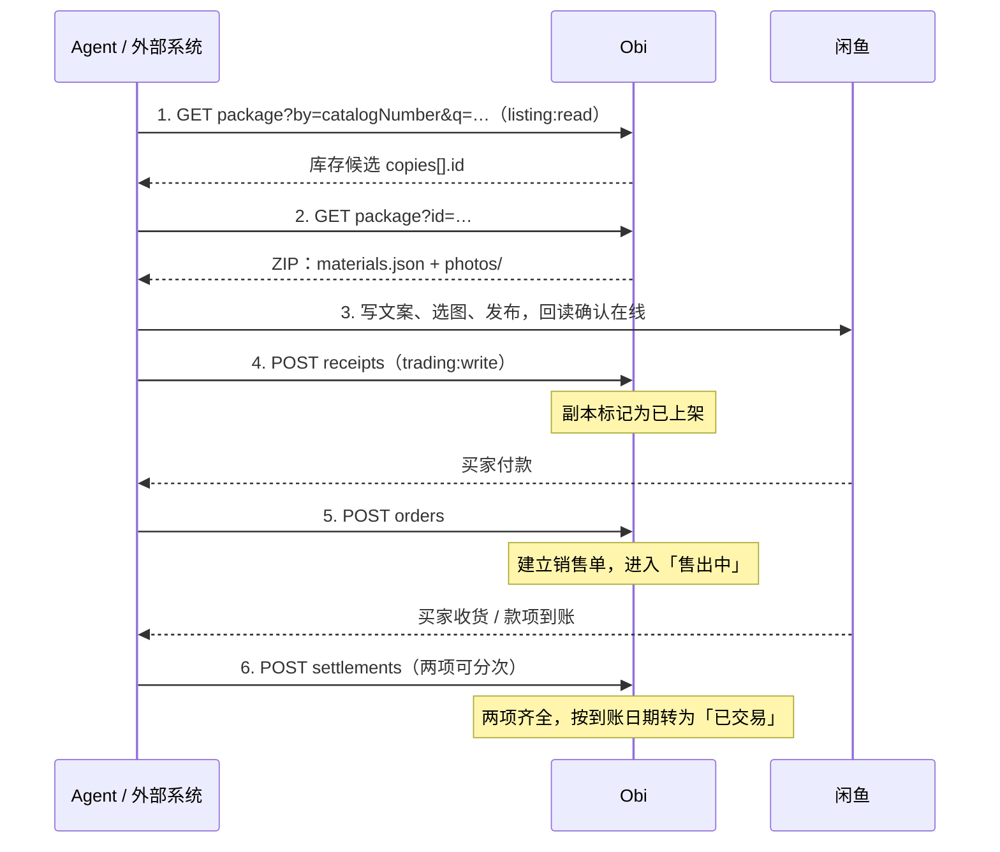
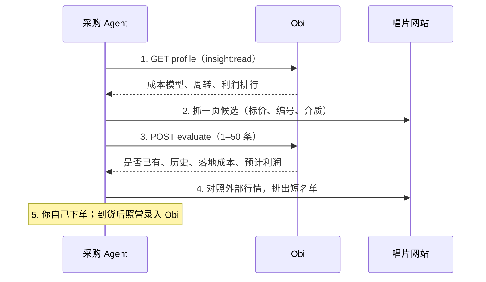

# 接口场景指南

按「要完成什么事」串起 Obi 服务器版的对外接口：每个场景列出谁在什么时候调用哪个接口、带什么、Obi 里发生什么变化。字段、错误码和边界以各接口契约为准：[Agent 资料包与交易同步](Agent上架接口.md)、[已购唱片查询](已购唱片查询接口.md)、[采购评估](采购评估接口.md)、[对外令牌](对外令牌.md)、[MCP 接入](MCP接入.md)；全部路由见 [HTTP 接口一览](HTTP接口一览.md)。介绍站的「接口」页是本文的流程轴版本。

## 开始之前

服务器版对每个调用方单独授权。在「设置 → 高级 → MCP 服务」为上架 Agent、订单监听器或采购 Agent 签发一枚令牌，只勾选它需要的权限。签发和轮换时复制令牌，改动立即对后续请求生效。客户端经 HTTPS 发送 `Authorization: Bearer <令牌>`。也可用命令行签发。

```sh
docker compose exec app python3 -m server.client_admin add 上架Agent --scope listing:read --scope trading:write
docker compose exec app python3 -m server.client_admin add 订单监听 --scope trading:write
docker compose exec app python3 -m server.client_admin add 采购Agent --scope insight:read
```

| 权限 | 能做什么 | 另需 |
| --- | --- | --- |
| `listing:read` | 查找库存副本、下载上架资料包（只读） | 开启「二手交易」 |
| `trading:write` | 登记上架回执、付款订单、收货与到账（写） | 开启「二手交易」 |
| `collection:read` | 查询有买入依据的副本（只读，不含金额） | 无 |
| `insight:read` | 采购评估：是否已有、成本与利润汇总（只读） | 无 |

按「谁在跑、跑在哪」分令牌，按「要做什么」配权限：无人值守的程序单独一枚，出问题单独撤销。旧的三个令牌文件仍按固定权限识别，迁移方式见[对外令牌](对外令牌.md#兼容)。

在 [MCP 客户端](MCP接入.md)填上 `https://your.domain/mcp` 和令牌，即可按权限调用下面的工具和场景模板。脚本或 n8n 可直接调用同一套 HTTP 接口。`get_listing_package` 返回 10 分钟内有效的 ZIP 下载链接，收到 409 时重新获取并核对资料。

各场景共用的约定：

- 错误响应都是带 `error` 的 JSON。没有任何调用方具有所需权限时返回 404，令牌无效返回 401，令牌有效但缺少该权限返回 403，参数无效或模块关闭返回 400，版本或绑定冲突返回 409。
- 写入口都可以安全重试：同一事实原样重发，返回同一结果和当前状态，不会重复建单。遇到 409 时保留手里的事实，核对后再提交。
- 金额是人民币字符串，最多两位小数；日期为 `YYYY-MM-DD`，时间为带时区的 ISO 8601。

## 场景一：闲鱼上架，一直到入账

> MCP 模板：`xianyu_listing`（把下面的步骤交给 Agent 执行）

Agent 负责查资料、写文案、发布和跟单；Obi 只提供资料、接收已经核实的事实并记账。调用方需要 `listing:read`（第 1–2 步）和 `trading:write`（第 4–6 步），一枚令牌挂两项权限即可走完全程。



### 1. 找到要卖的那一张

> MCP 工具：`find_listing_copies`

```http
GET /api/listing/agent/package?by=catalogNumber&q=WPCR-0001
```

`by` 可选 `text`（默认，艺人与专辑名）、`barcode`、`catalogNumber`。只返回国内和海外库存。每页最多 20 项，`nextOffset` 续页。同一专辑有多个副本时，先选定一件，记下它的 `id`。

### 2. 下载这一张的资料包

> MCP 工具：`get_listing_package`

```http
GET /api/listing/agent/package?id=0123456789abcdef0123456789abcdef
```

返回 ZIP：`materials.json`（副本 `id`、`revision`、照片版本与顺序、`album` / `release` / `copy` 三组资料）和按顺序编号的原图 `photos/01.jpg`…。只要资料传 `photos=0`；换图或调整顺序传 `order=0,2` 和当前 `photoRevision`。资料包不含成本、渠道和私人备注；品相只以本副本照片和确认过的实物信息为准。

记下清单里的 `revision`，第 4 步要用。

### 3. 发布（外部系统）

文案、选图、定价、发布都在 Obi 之外完成。发布后回读商品页，确认确实在线，再进入下一步。

### 4. 登记上架回执

> MCP 工具：`record_listing_receipt`

```http
POST /api/listing/agent/receipts
```

```json
{"id": "0123…cdef", "revision": 2, "itemId": "100000000001", "status": "online",
 "price": "95.00", "shipping": {"mode": "free"}, "verifiedAt": "2026-10-08T05:30:00Z"}
```

运费方式为 `free`、`fixed`（带 `amount`）、`actual` 或 `pickup`。Obi 把副本标记为已上架，存下商品链接；返回最新 `revision`。同一闲鱼商品只能绑定一张副本。

### 5. 买家付款：登记订单

> MCP 工具：`record_paid_order`

```http
POST /api/trading/agent/orders
```

```json
{"orderId": "DEMO-XIANYU-001", "itemId": "100000000001", "date": "2026-10-09",
 "gross": "90.00", "fees": "3.00", "postage": "7.00"}
```

以闲鱼订单号为键，`gross` 是实际成交价（与上架标价分开保存），`fees` 是平台扣费，`postage` 是卖家付的寄出运费，省略按 `0.00`。Obi 建立销售单，副本进入「售出中」。已有手动销售单时，核对一致后返回原单。

### 6. 收货与到账

> MCP 工具：`record_settlement`

```http
POST /api/trading/agent/settlements
```

```json
{"orderId": "DEMO-XIANYU-001", "buyerReceived": true, "settledDate": "2026-10-14"}
```

两项事实可以分次、按任意顺序提交。只有一项时仍是「售出中」；两项齐全后按实际到账日期转为「已交易」，计入利润。订单还没登记时返回 409：先补第 5 步再重试。

## 场景二：买之前，查一下是不是已经有了

> MCP 工具：`find_purchases`；模板 `check_before_buying`

只需要 `collection:read`，不要求开启任何模块。

```http
GET /api/collection/purchases?by=catalogNumber&q=UICE-0003
```

`by` 可选 `text`（默认）、`catalogNumber`、`barcode`；可加 `status` 只看某一状态。结果里 `held`（在库，含上架未成交）或 `in_transit`（入库在途）说明已经有了；`sale_pending`、`resold`、`removed` 是买过但已卖出或移除，可用来回顾购买历史。空结果表示没找到可确认的买入记录。按名称查到的候选，再用编号、条码和介质核对版本。

响应只有发行资料和副本状态，不含金额、渠道、订单、备注和照片。

## 场景三：采购时挑出值得买的

> MCP 模板：`purchase_scouting`（把下面的步骤交给 Agent 执行）

Agent 在唱片网站浏览商品，用你自己的买卖证据判断哪张值得买：是否已有、这一版你通常花多少、卖出实收多少、多久卖掉，以及按你的成本口径估算的落地成本和预计利润。只需要 `insight:read`，不要求开启任何模块。抓取网站、对照外部行情、排序和下单都在 Obi 之外。



### 1. 读买卖画像

> MCP 工具：`get_purchase_profile`

```http
GET /api/insight/profile
```

开工前读一次：`costModel` 给出当前日元汇率、你实际付出的汇率、按 CD / LP 分开的每张国际运费和整批费用、国内寄出运费和平台扣费率，用来把网站标价换成落地成本；`turnover` 是卖出与在库天数；`top` 是近期最赚钱的艺人和厂牌。所有统计按发生日期加权，半年前的一笔算半票，可用 `halfLifeDays` 调整。

### 2. 抓候选（外部）

Agent 在网站上抓到一页商品，尽量带上唱片编号或条码、介质（CD / LP）和标价。

### 3. 批量评估

> MCP 工具：`evaluate_candidates`

```http
POST /api/insight/evaluate
```

```json
{"candidates": [{"ref": "shop-123", "catalogNumber": "WPCR-0001", "format": "CD",
                 "price": "1980", "currency": "JPY"}]}
```

每条返回 `match`（同一版本、同专辑其他版本、同艺人或没有）、`owned`（在库与在途张数）、`history`（这一级的买入成本、卖出净收入、利润、周转、已上架未售出）和 `estimate`（落地成本拆分、预计净收入与利润）。只有 1 条样本时金额给区间，没卖过时预计利润为 `null`，由 Agent 用外部行情补。单张深挖用 `GET /api/insight/releases?catalogNumber=…`，参数同一条候选。

### 4–5. 排序与下单（外部）

Agent 结合外部行情，按预计利润、利润率、周转和样本数排序，给你附链接和理由的短名单。Obi 不保存候选，也不下单；到货录入后，新数据自动进入下一次评估。

## 场景四：部署与监控

```http
GET /api/health
```

免登录，返回 `ok`、构建 `version`、账本结构版本 `schema` 和运行时长 `uptime`；数据库不可用时返回 503。部署脚本用它做健康检查，外部监控可定时探测。

备份、导出与恢复属于实例管理，需要登录会话，见 [HTTP 接口一览](HTTP接口一览.md#账户与实例管理)。
