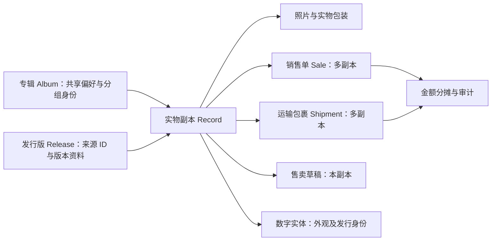
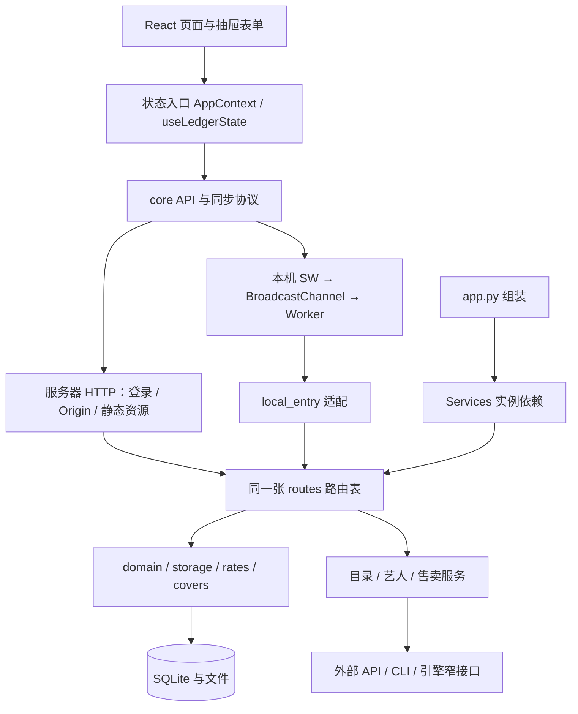

# Obi 架构全景 · 2026-11-04

> 后续实施：I-018 / I-019 / I-020 已加入修复与回归，详见[可靠性实施记录](log/2026-11-04-reliability-boundaries.md)。本文统计与故障探针保留分析时点口径。

这次分析的核心判断：Obi 已经是一套**以独立实物为中心、可组合业务能力、跨运行环境的个人软件系统**。现在最值得投入的是持久化、运行能力与交付一致性这三类边界，其次才是计算速度。你的审美也已不只是颜色与圆角，而是对空间连续性、信息归属和操作控制权的持续要求。

本组报告包含：[架构全景](架构全景-2026-11-04.md)、[性能与可靠性](性能与可靠性-2026-11-04.md)、[历史与个人工程体系](历史与个人工程体系-2026-11-04.md)。这是分析快照和建议，不是新增产品定案。

## 1. 范围与证据

- 基线：HEAD `1d9b9fd`，分析开始时工作树干净，与本地 origin/main 相同；未 fetch，因此不代表远程此刻没有新提交。
- 仓库非 shallow。枚举本地所有分支、远程跟踪引用、tag 和部署引用：504 个可达提交对象；HEAD 可达 351 个，其中非 merge 347 个；94 个 tag；889 个跟踪文件。
- 全部可达提交的时间、标题、文件增删统计已扫描；HEAD 的全部提交另做逐文件触及与共改统计。架构关键提交深入看变更内容，当前关键执行链读源码核对。**不是逐行审计全部 504 份补丁，也不包括不可达对象、reflog、未拉取远程历史或 Git 建库前的会话。**
- Git 从 2026-09-30 的 v2.0 基线开始。此前产品形成过程来自《AI开发复盘》及历史文档，不能伪称完整 Git 记录。
- 历史重写（D-020）造成相同日期/标题的不同提交对象；504 不能直接解释为 504 次独立开发。所有引用的日期+标题去重为 348，仅为重复诊断，不能据此认定补丁相同。主线热点统一采用 351 个提交口径。
- 当前根目录与 server 下共 55 个 Python 模块，server 42 个；web/src 352 个跟踪文件；android 33 个；docs/log 原有 232 个文件。数量不是质量分数。
- 本次运行后端 584 项、前端 176 项测试，全部通过；typecheck、生产构建通过。另做固定样本微基准、归档恢复故障注入和 Worker 同步错误注入，结果见第二篇。
- 未读取个人 data，未部署、提交、推送，未实测手机、真实模型账户、在线资料源或生产负载；没有以桌面微基准推断真机速度。此次只增加分析与问题记录，未修业务代码。

## 2. 产品实际包含什么

| 能力 | 使用者得到什么 | 主要实现与边界 |
|---|---|---|
| 收藏底座 | 一张实物一条记录；版次、侧标、包装、照片、备注、回收站；同专辑多副本可分组 | domain、storage；RecordForm、DetailDrawer、ShelfPage；分组不合并副本成本与身份 |
| 购入记录 | 原币金额、日期、渠道、附加费用、实际人民币成本、成本未知 | domain、rates、storage；MoneySection、PurchaseForm；Decimal 记账 |
| 海外周转 | 海外库存、包裹、运费分摊、在途、到货及撤销 | Store.ship / shipment_action / update_shipment；TransitPage、ShipForm |
| 二手交易 | 平台上架标记、合单成交、售出中、确认收货、退款/退货、净额和利润 | Store.sell / sale_action / update_sale；ShippingPage、TradesPage、SaleForm |
| 统计与导出 | 成本、收入、利润、审计；库存/交易 CSV | StatsPage、server/export_csv；未知成本不能当成零利润成本 |
| 查版与录入 | 相机扫码、照片检测、条码/编号精确查版、文字找专辑、展开版本、手动录入 | BarcodeScanner、useReleaseLookup、LookupPage；release_catalog 与多源客户端 |
| 封面与艺人 | 此版本/同专辑/数字封面来源区分；上传封面；艺人身份、资料、作品目录 | covers、musicbrainz、catalog_art、artists、group_covers；身份与图片来源分开 |
| 收藏展示 | 九种布局、手动分组、喜欢、巡游、沉浸、2D 灯箱 | GalleryPage、GalleryFocus、gallery 数学与运动 hooks；展示与交易状态分开 |
| Album Engine 插件 | 安装/卸载独立引擎，挂载 3D、校准及已有实体能力 | engine_plugins、album_engine_adapter、EngineMount；生成与物理规则由引擎拥有 |
| 售卖辅助 | 复用已选版资料，核对照片、生成文案、风格预设、候选采用、复制和取图 | listing_*、domain_listing、ListingForm；不自动发布、不自动改上架状态 |
| 身份与设置 | 单用户登录、密码、主题、功能组合、首页、服务商配置 | security、AppContext、SettingsPage；服务商凭据独立于业务备份 |
| 数据与交付 | 完整 ZIP、每日数据库快照、恢复、服务器更新、安卓签名更新 | archive、backups、ship、ContentPatch、Updater；各自保存范围不同 |

已删除或移出的能力不能算作当前功能：照片批量识别录入、宿主 3D 生成管线、旧 RYM 直达、新建旧式 JSON 导入入口。售卖照片分析仍存在，它的目的与早期照片录入不同。

## 3. 领域结构：四种身份，多个独立维度

专辑、发行版、副本、交易单不是同一对象。喜欢属于专辑；照片与品相属于副本；条码识别的首先是发行资料；一笔成交可能包含多副本。把它们统一成一个“大 Album 对象”会重新引入历史错误。

生命周期有 overseas、transit、domestic、shipping、sold、trash；listed 是另一维度，不能推导“未上架就是不出售”。展示分组、来源核对状态、模型能力、包装完整性也不应挤进生命周期枚举。

数据库不是每种概念各一张关系表：主体是 records / sales / shipments 的 id + JSON，另有 audit、meta。专辑实体、偏好、插件状态等通过 meta 管理。这样迁移灵活、事务集中，但字段校验与关系完整性主要由 Python 负责；SQL 无法自动替你保障整个领域。

storage.py 的 1,537 行既包含合理的事务内聚，也包含目录重建、照片切换、恢复与实体任务等复杂度。项目明确要求它保持单文件；改进应先厘清方法契约、事务边界与读取入口，不能为了 200 行指标拆碎跨表事务。

## 4. 模块怎样组合

功能组合只有四个开关：acquisition、trading、circulation、showcase，收藏底座始终存在。海外周转依赖购入；其他组合由 core/modules 与后端 clean_modules 约束。五种预设只是默认配置，不是五套应用；关模块收入口并约束新操作，保留历史数据。

这里至少有三种“模块”：产品能力开关、源码分层、可安装插件。它们不能混为一谈。关展示不会删除插件和实体；文件拆成一个组件也不意味着成为可发布插件。

- app.py 负责组装和生命周期，HTTP 层负责协议，routes 负责分发；业务通过 Services 注入。新增功能有明确入口，是适合单人和 AI 协作的模块化单体。
- 前端 core → components → pages/forms 的单向依赖已有测试；state 提供统一访问入口。页面按需加载，但整个 AppContext 仍是宽广播面。
- plugins 是真正的运行时扩展边界；业务开关通常仍在同一个进程、同一个数据库事务域里。当前没有必要改成微服务。
- 最重要的隔离是业务事实不依赖展示、外部模型不能直接改账、插件卸载不删除资产、环境差异不复制业务规则。

## 5. 五条关键执行链

**读取。** api_state 先读库文件指纹、汇率状态、服务信息；命中 Services.state_cache 直接复用序列化结果。未命中才 Store.state 全表解析、汇率处理、成本利润派生、序列化；响应依客户端基线走 304、整份或行级 delta。前端 fetchState 重建后交 useLedgerState；旧请求不得覆盖刚确认的元数据保存。

**编辑资料。** 前端照片压缩并通过两路队列先暂存，保存只带 token；路由锁外查版核验，锁内 Store.save；revision 检查、审计、共享笔记、专辑目录更新与照片切换日志在事务里。提交后执行目录切换；启动补完未完成日志。响应只合并受影响资料和审计，不刷新汇率。注意：准备/读取照片与目录重建仍在 Store.save 内，不等于锁内只剩一条 SQL。

**财务操作。** 表单发送销售/运输等命令，路由写锁、领域校验、跨记录事务、分摊和审计，随后前端刷新派生账本。日元运费需要即时折算，缺汇率时应拒绝，不能为了快而假装成本已知。这些命令仍可能在写锁内查汇率。

**资料检索。** 条码走 MusicBrainz、Deezer、iTunes；编号走 MusicBrainz、Discogs、NDL；各自节流/缓存，服务端共享总等待期限，release_merge 按身份合并。查询候选、人选发行版、保存时核对是不同步骤。数字发行不能推成 CD 实体；NDL 无条码，不能替代条码验证。

**售卖准备。** 读取当前副本与照片版本，截取白名单上下文，固定服务商/模型快照，串行做核对和写作；相同分析可复用，换风格只重写。仅空白草稿自动保存；已有文案先给候选。任务失败不能自动换付费来源；任务内存态与已保存草稿的持久性不同。

## 6. 同一业务，三种运行合同

| 维度 | Docker / 裸机 | 浏览器本机 | 安卓本机 |
|---|---|---|---|
| Python | CPython 服务进程 | Pyodide Worker | WebView 内 Pyodide |
| 持久化 | 本机 SQLite + 文件 | 内存 FS → IDBFS → IndexedDB | 同左，绑定固定 appassets 源 |
| 网络 | 标准库 HTTP；可用服务商按配置 | 同步 XHR，受 CORS 限制 | 同左，加窄范围原生模型中继 |
| 并发 | HTTP 线程、来源线程池、后台任务 | main/net 两 Worker；池替身同步执行 | main/net；售卖推理会占 main |
| 认证/插件 | 登录、配置的模型通道、可安装引擎 | 无服务器登录、无可安装引擎、无售卖识别 | 支持约定的密钥模型通道；其余能力有限 |
| 更新 | 发布包/镜像与进程切换 | 静态站点与 SW 更新 | 网页补丁与原生 APK 两条线 |

同路由、同领域代码是很好的资产，但不能称为“所有平台行为相同”。并发、持久化确认、网络能力、取消和更新都需要独立合同与平台验收。本机主 Worker 内的 state 汇率或艺人操作仍可阻塞账本，net Worker 不能自动解救所有网络路径。

## 7. 当前结构值得保留与收紧之处

保留：Decimal 与 null 语义、独立副本、事务审计、精确身份合并、元数据与财务写入分离、显式服务组装、固定样本、引擎所有权、完整备份与表格导出的语义分离。

收紧：routes 同时承担 691 行路由与处理逻辑；WRITE_LOCK、state_sync 快照等仍为模块级可变状态；server 层仍有直连 Store.connect 的读取/个别写入；前端统一上下文承担数据、导航、选中、抽屉和插件等多类更新。它们不全是现成故障，却是多实例复用与后续变更的阻力。

不宜照搬旧报告的结论：分层反向依赖、所有页面阻塞首屏、每次强制下载更新日志、构建产物进 git、单副本照片无崩溃恢复，已经分别有当前实现处理。也不能从若干毫秒级函数断言“全应用已经理论最优”。
